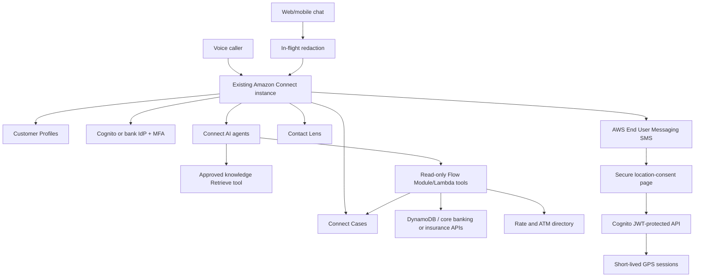

# 1. Architecture

## Design principles

1. Use native Amazon Connect features before custom services.
2. Treat Customer Profiles as the Connect-facing customer identity.
3. Treat DynamoDB and the bank/insurer core platform as authoritative operational sources.
4. Treat Connect Cases as the ticket and activity system.
5. Keep public knowledge separate from authenticated customer data.
6. Use retrieval for approved explanatory content and tools for changing numeric facts.
7. Do not expose full customer records to an LLM.
8. Require authentication before account, policy, vehicle or case disclosure.
9. Do not approve lending, transfer money, infer coverage, or make liability decisions.
10. Deploy new flows alongside existing flows and cut over only after acceptance testing.

## Logical architecture

The location page is stored in a private, versioned S3 bucket and served only
through an HTTPS CloudFront distribution using Origin Access Control. It uses
Cognito authorization code with PKCE before calling API Gateway.

## Data ownership

| Data | Primary service | Notes |
|---|---|---|
| Name, phone, email, addresses, profile ID | Customer Profiles | Search and Connect association |
| Vehicle, driver, policy reference | DynamoDB/core insurer | Read-only minimum data returned to Connect |
| Banking account/application reference | Core bank/DynamoDB adapter | Masked read-only responses |
| Ticket status/comments | Connect Cases | Associated with a Customer Profile |
| Approved procedures and FAQs | Connect knowledge base | Versioned, reviewed and cited |
| Current rates | Authoritative structured rate table/API | Never inferred from prose |
| ATM/branch directory | Authoritative directory | Amazon Location can add route calculations |
| Chat/contact transcripts | Connect/S3 | Redacted, encrypted and retained by policy |
| Current mobile GPS | Current-location TTL table | Authenticated customer, accuracy, observation time and expiry |
| One-time browser GPS | Location-session TTL table | Consent, contact correlation, optional altitude and single-use submission |

## Trust states

| State | Permitted |
|---|---|
| Public | General FAQs, published rates, ATM/branch location |
| Identified | Privacy-safe greeting; no private disclosure |
| MFA authenticated | Masked account/policy/application/case information |
| Step-up authenticated | Only explicitly approved profile changes |
| Human escalation | Same authorization boundary; additional staff controls |

## Lambda tools

| Function | Purpose | Mutating? |
|---|---|---|
| `customer-context` | Masked vehicle/policy context after verification | No |
| `product-rates` | Effective authoritative product rate | No |
| `atm-locator` | Rank approved ATM directory records | No |
| `cases-context` | Recent cases and latest comments | No |
| `message-processor` | Block credential disclosures in chat | Transforms message only |
| `location-session` | Create and submit single-use GPS session | Yes, isolated TTL table |

The same location Lambda also accepts authenticated Android updates into the
separate current-location table and retrieves a non-expired position for
Amazon Location enrichment.

The first release intentionally contains no money movement, loan decision, coverage decision, beneficiary management or credential-management tool.

## AWS references

- [Customer Profiles flow block](https://docs.aws.amazon.com/connect/latest/adminguide/customer-profiles-block.html)
- [Cases flow block](https://docs.aws.amazon.com/connect/latest/adminguide/cases-block.html)
- [Agentic self-service](https://docs.aws.amazon.com/connect/latest/adminguide/agentic-self-service.html)
- [AI-agent MCP and Flow Module tools](https://docs.aws.amazon.com/connect/latest/adminguide/ai-agent-mcp-tools.html)
- [In-flight chat redaction](https://docs.aws.amazon.com/connect/latest/adminguide/redaction-message-processing.html)
- [Knowledge retrieval configuration](https://docs.aws.amazon.com/connect/latest/adminguide/multiple-knowledge-base-setup-and-content-segmentation.html)
